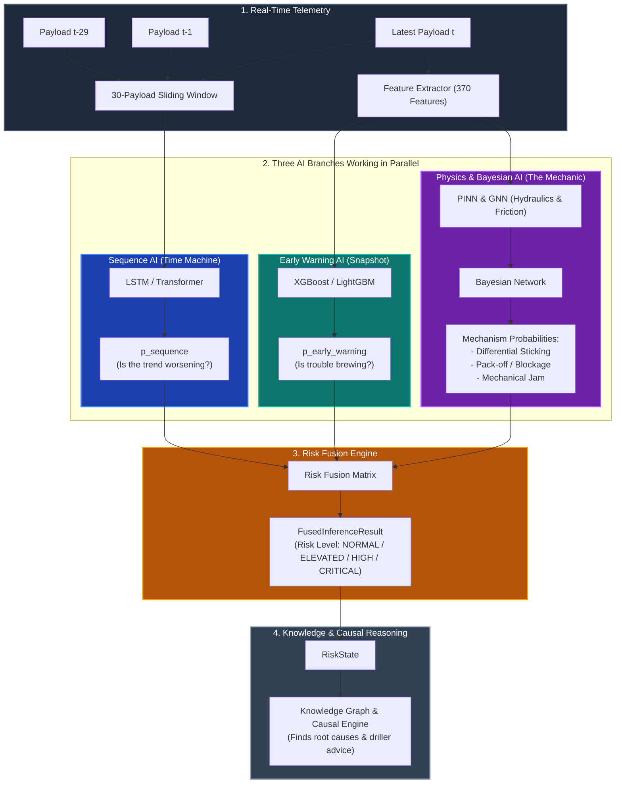

# The Drilling Intelligence Platform: Pipeline Architecture (Plain English Guide)

This guide explains how our stuck-pipe prediction and risk intelligence pipeline works in simple, straightforward terms. Use this to explain the architecture to colleagues, mentors, or stakeholders.

---

## 1. The Big Picture

When drilling an oil & gas well, sensors at the rig measure conditions (pressure, rotation, torque, mud flow) every 10 to 30 seconds. A single sensor record is called a **Payload**.

If the drill pipe gets stuck in the hole (**Stuck Pipe**), it can cost millions of dollars in downtime. 

Our platform does 3 things:
1. **Detects trouble early** (15 to 60 minutes *before* the pipe gets stuck).
2. **Identifies the physical cause** (differential sticking, cuttings pack-off, or mechanical jam).
3. **Fuses the results** into a single clear risk score before asking the Knowledge Graph for root-cause diagnosis.

---

## 2. End-to-End System Architecture



---

## 3. The 3 AI Branches Explained Simply

Think of the three branches like a team of three specialized engineers analyzing the well at the same time:

### Branch 1: Early Warning (The "Snapshot Doctor")
* **What it asks:** *"Looking at the current sensor readings and their recent trends, does this well look sick or healthy right now?"*
* **How it works:** 
  * It takes the latest sensor payload and calculates **370 features** (rolling averages, changes over 1 minute, 5 minutes, 15 minutes, and ratios like Standpipe Pressure to Flow Rate).
  * It passes these 370 numbers into fast gradient-boosted decision trees: **XGBoost, LightGBM, CatBoost, and Random Forest**.
* **Target Label (`y_warn`):**
  * `0` = Normal drilling.
  * `1` = Warning precursor (trouble is likely 15 to 60 minutes in the future).
* **Output:** A warning score between `0.0` and `1.0`.

---

### Branch 2: Sequence AI (The "Movie Watcher")
* **What it asks:** *"Watching the sequence of the last 30 readings like a video, is a dangerous pattern developing over time?"*
* **How it works:**
  * Rather than looking at one snapshot, it takes a **sliding window of 30 consecutive payloads** (about 10–15 minutes of drilling history).
  * It uses temporal neural networks (**LSTM, GRU, TCN, and Transformer**).
  * It catches subtle continuous patterns, such as gradual pressure creep or erratic torque oscillations that individual snapshots might miss.
* **Target Label (`y_seq`):**
  * Predicts whether an incident will occur within a **15-minute horizon** (`horizon_seconds = 900`).
* **Output:** A temporal sequence risk score between `0.0` and `1.0`.

---

### Branch 3: Physics AI & Bayesian Network (The "Physics Professor")
* **What it asks:** *"If there is a risk, what physical mechanism is causing it?"*
* **How it works:**
  * **Physics-Informed Neural Network (PINN):** Applies laws of fluid dynamics (mud hydraulics, Bingham plastic pressure drop, friction) to estimate downhole conditions sensors cannot see directly.
  * **Graph Neural Network (GNN):** Treats the wellbore and drillstring as connected physical segments to see where cuttings are clumping or where the pipe is contacting the rock.
  * **Bayesian Network:** A probabilistic cause-and-effect network. It combines operational facts (Is the pipe static? Are the pumps off? Is mud pressure higher than formation pressure?) with the physics models.
* **Output:** Specific stuck-pipe mechanism probabilities:
  1. **Differential Sticking Risk** (e.g., high mud weight pushing static pipe into permeable filter cake).
  2. **Pack-off / Annular Blockage Risk** (e.g., cuttings accumulation choking the borehole).
  3. **Mechanical Jamming Risk** (e.g., doglegs, key seats, or collapsing formations).

---

## 4. Risk Fusion: Making a Single Decision

During real-time drilling (inference), all three branches run simultaneously. 

The **Risk Fusion Engine** takes all their answers and combines them:
- It checks if the Early Warning models agree.
- It verifies if the Sequence AI sees a developing temporal trend.
- It factors in the mechanism probabilities from the Physics & Bayesian branch.

### Final Alert Levels:
* 🟢 **NORMAL (0.00 – 0.39):** Wellbore is stable. Normal drilling.
* 🟡 **ELEVATED (0.40 – 0.69):** Early anomalies spotted. Driller should monitor trends.
* 🟠 **HIGH (0.70 – 0.84):** Clear precursor detected. Action needed (e.g., circulate cuttings, reciprocate pipe).
* 🔴 **CRITICAL (0.85 – 1.00):** Imminent stuck-pipe event! Immediate preventative action required.

---

## 5. Output Format (Before the Knowledge Graph)

Right after Risk Fusion finishes, it produces a clean, structured payload called `FusedInferenceResult`. This is the exact object sent to the Knowledge Graph layer:

```json
{
  "well_id": "WELL-ALPHA-01",
  "timestamp": "2026-10-16T14:30:00Z",
  "fused_risk_score": 0.78,
  "risk_level": "HIGH",
  "dominant_mechanism": "pack_off_annular_blockage",
  "mechanism_probabilities": {
    "differential_sticking": 0.12,
    "pack_off_annular_blockage": 0.74,
    "mechanical_stuck": 0.14
  },
  "branch_contributions": {
    "p_early_warning": 0.81,
    "p_sequence": 0.76,
    "p_physics": 0.74
  },
  "top_anomalous_features": [
    "spp_rolling_mean_300s_spike",
    "flow_out_flow_in_ratio_drop",
    "torque_variance_60s_increase"
  ]
}
```

---

## 6. How It Hands Off to the Knowledge Graph

Once the `FusedInferenceResult` is generated:
1. An **Observation Adapter** converts it into a standardized `RiskState`.
2. The platform queries the **Knowledge Graph** and **Causal Engine**:
   * *"We have a HIGH risk of Annular Pack-off with rising SPP and dropping flow ratio. Have we seen this in offset wells in this formation?"*
   * *"What SOP (Standard Operating Procedure) should the driller execute right now to prevent total blockage?"*
3. The driller gets both the alert and an actionable, plain-English recommendation.

---

## 7. Summary Cheat-Sheet

| Component | Question It Answers | Input | Key Model(s) | Output |
| :--- | :--- | :--- | :--- | :--- |
| **Early Warning** | *Is something abnormal right now?* | 1 payload → 370 features | XGBoost, LightGBM, CatBoost, RF | `p_early_warning` (0–1) |
| **Sequence AI** | *Is the 10–15 min trend heading towards danger?* | Window of 30 payloads `(30, 370)` | LSTM, GRU, TCN, Transformer | `p_sequence` (0–1) |
| **Physics AI & Bayesian** | *Why is it happening physically?* | Physical telemetry + wellbore geometry | PINN, GNN, Bayesian DAG | Probabilities for Diff Sticking, Pack-off, Mechanical |
| **Risk Fusion** | *What is the final overall risk and dominant cause?* | All model predictions combined | Fusion rule matrix / weighted ensemble | `FusedInferenceResult` (`NORMAL` to `CRITICAL`) |
| **Knowledge Subsystem** | *What caused this historically and how do we fix it?* | `RiskState` from Fusion result | Knowledge Graph & Causal Engine | Root-cause explanation & driller SOP advice |
